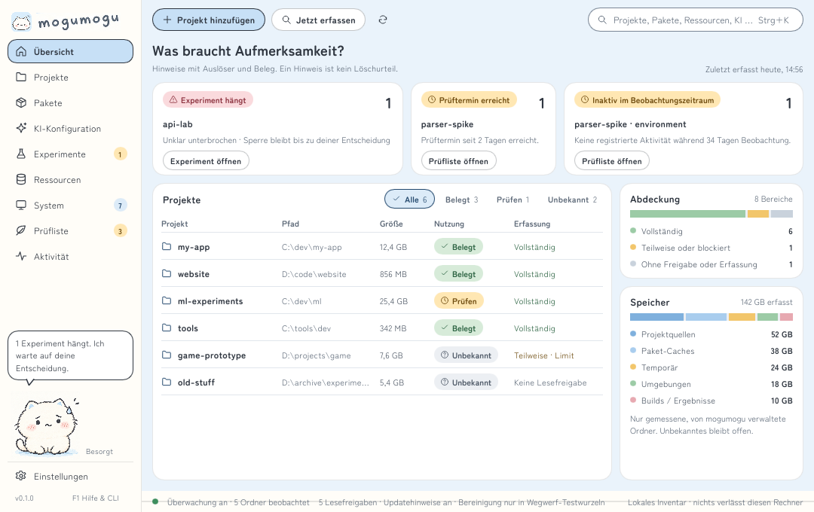

# mogumogu

**Lokales Entwicklungsinventar als Windows-Tray-App · Windows 10/11 · Rust · Slint · SQLite · GPL-3.0-only**

mogumogu zeigt, welche Entwicklungsressourcen auf deinem Rechner existieren, wem sie gehören, welche Nutzung tatsächlich beobachtet wurde und was eine Prüfung verdient: Projekte, Pakete aus 35 Paketmanagern, Laufzeitvorgaben, Container-Images und CI-Actions, Python-Umgebungen, Build-Ausgaben, Tests, Scratchpads und die KI-Konfiguration von zwölf Clients. Alles bleibt lokal – kein Konto, keine Cloud, keine Telemetrie.



Mochi begleitet die Oberfläche mit dem ausgewählten Kopf-Icon und handgeschriebenen
Schriftzug. Die eingebettete runde Schrift **Zen Maru Gothic** unterstützt auch
japanische Projektnamen. Mochis Ausdruck folgt Ansicht und Zustand: Mochi mampft
während einer Erfassung und schaut besorgt, wenn ein Bereich nur teilweise
erfasst ist.
[Gestaltung und Assets](design/brand/index.html).

> **Grundsatz:** Keine beobachtete Nutzung ist kein Entbehrlichkeitsnachweis. Registrieren erlaubt kein Lesen, Lesen erlaubt kein Löschen. Bereinigt wird nur, was wiederherstellbar belegt ist, und nur in den Papierkorb; bis zum unabhängigen Review ausschließlich in ausdrücklich markierten Wegwerf-Testwurzeln.

## Stand

Die Basis des [Implementierungsplans](docs/IMPLEMENTIERUNGSPLAN.md) ist innerhalb der veröffentlichten [Unterstützungsmatrix](docs/UNTERSTUETZUNGSMATRIX.md) umgesetzt. Neu sind [Entwicklungsfunde mit Projektzuordnung, Laufwerksdashboard und Skill-Inhaltsansicht](docs/ENTWICKLUNGSFUNDE.md). Dazu kommen [Systembefund](docs/SYSTEMERKENNUNG.md), die [Laufwerkssuche nach Projekten und Scratchpads](docs/ENTWICKLUNGSFUNDE.md#laufwerkssuche), gesammelte Projektübernahme, globale Suche, [Paketbelege](docs/PAKETPRUEFUNG.md) und die [Speicheranalyse](docs/ENTWICKLUNGSFUNDE.md#speicheranalyse) für Ordner und lokale Festplatten. Scratchpad-Zweck und Konfigurationsvorrang werden nicht automatisch festgestellt. Die neuen Lesewege wurden durch einen getrennten Agenten geprüft; für die Laufwerkssuche, die die Lesegrenze auf ganze lokale Festplatten erweitert, steht der zweite Review noch aus. Die Speicheranalyse, die Dateimetadaten ganzer lokaler Festplatten liest, hat ein getrennter Agent geprüft; seine Befunde sind behoben, ein menschlicher Review steht aus. Menschliche Sicherheitsabnahme, Windows-11-Abnahme und der unabhängige Review G5 des neuen Papierkorb-Wegs stehen aus. Produktive Bereinigung bleibt gesperrt. Details: [Validierung](docs/VALIDIERUNG.md), [Messbericht](docs/MESSBERICHT.md).

| Fähigkeit | Umfang |
|---|---|
| Tray und Dashboard | Kompaktes Windows-Fenster mit sechs Ansichten (Übersicht mit Prüfhinweisen, Projekte, Pakete, KI-Konfiguration, Speicher, Einstellungen), Speicherübersicht für Laufwerke und Projekte mit Laufwerkssuche, Projekt hinzufügen in drei Schritten, globaler Suche und Tastaturnavigation; Tray mit Statuszeile und Prüfhinweisen; Lokalmodus als Standard, Demo separat |
| Lesefreigaben | Pro Ordner, an die Ordneridentität gebunden; für die reine Namenssuche und die Speicheranalyse (nur Dateimetadaten) auch pro lokaler Festplatte, an die Laufwerksidentität gebunden; Junctions, Symlinks und Cloud-Platzhalter werden nie verfolgt |
| Inventar | 35 Paketmanager statisch je Projekt (npm, pnpm, Bun, Yarn, Deno, pip, uv, Poetry, Pipenv, PDM, Conda, Cargo, NuGet, Paket, Go-Module, Gradle, Maven, sbt, Composer, Bundler, pub, Mix, Elm, SwiftPM, CocoaPods, Carthage, vcpkg, Conan, Zig, Terraform/OpenTofu, Helm, Nix, Bazel, renv, Julia), dazu als deklarierte Abhängigkeiten Laufzeit- und Werkzeugvorgaben, Container-Images, GitHub Actions, pre-commit-Hooks und Git-Submodule; globale npm-, uv-, Cargo- und NuGet-Bestände nach eigener Freigabe; deklariert/aufgelöst/installiert getrennt |
| KI-Konfiguration | Projektdateien für Agent Skills, Codex, Claude Code, Copilot/VS Code, Cursor, Gemini, Windsurf, Cline, Roo, OpenCode, Continue, Aider sowie persönliche Ordner bekannter Clients nach eigener Freigabe – als Daten, nie ausgeführt; Reiter **Zugriff** stuft je Ordner ein, wie weit die Werkzeuge laut Einstellungen reichen (Bestätigungen aus, Ordner außerhalb, Hooks, Lese-Verbote, Ignore-Dateien, Sandbox), und ergänzt nach Vorschau und Bestätigung Leseverbote für Claude Code in der persönlichen `.claude/settings.local.json`, für ein Projekt oder alle zusammen |
| Generationen | Vergleichsbasis ohne Meldungsflut, gruppierte Änderungen, keine falschen Entfernungen nach Teilläufen |
| Scratchpads | Registrieren/Übernehmen und automatische Kandidatensuche in freigegebenen Ordnern und ganzen Laufwerken; mögliche Scratchpads nach Ordnernamen (scratch, spike, poc, playground …) oder losen Skripten ohne Projektmarker; Funde für Skripte, Notebooks, Testordner (Zahl der Testdateien und Frameworks nach Dateinamen), Umgebungen, Ausgaben, Testdaten und Datenbanken; explizite Zuordnung mit Zweck und Schutz; gefundene Scratchpads gesammelt geschützt übernehmen |
| Prüfhinweise und Bereinigung | Hinweise mit Evidenz; Papierkorb-Plan nur für wiederherstellbar belegte Ordner (Lockfile oder Build-Datei daneben, in Git-Repositorys ohne versionierte Datei laut Index), behaltene Ordner nie, Bestätigung per Fingerabdruck und Ausführung nur im Dashboard (die CLI plant nur), erneute Prüfung direkt vor dem Verschieben, journalisierte Ausführung, gemessener freier Speicher vorher/nachher, Abgleich nach Absturz; Ordner, die ein registrierter KI-Lauf meldet, eine überwachte Datenbank oder ein Container einbindet, nie ([Projektbewusste Bereinigung](docs/PROJEKTBEWUSSTE-BEREINIGUNG.md)) |
| KI-Läufe und Docker | Auf Wunsch registrieren kooperierende Agenten per CLI Läufe, Artefakte und Docker-Objekte – nur Herkunft und Schutz, kein Befehl entfernt etwas; einen beendeten Lauf gibst nur du im Dashboard frei; schreibgeschütztes Docker-Inventar freigegebener lokaler Kontexte (Container mit eingebundenen Projektordnern, Images, Volumes, Netze, Docker-Speicherbilanz) nur über `GET` an die lokale Named Pipe |
| Datenbanken | Überwachung registrierter Datenbankdateien, Datenordner und Docker-Volumes (Dashboard oder CLI `db register`): Größe, Dateizahl und letzte Änderung nur aus Metadaten, Verlauf und Wachstum; nie geöffnet, nie kontaktiert, immer gehalten; Vorschläge aus bekannten Installationsordnern, Datenbankdateien der Projekte und Volume-Namen; Überwachung beenden nur im Dashboard |
| Paketbelege | Version und Quelle getrennt; Projekt-Lockbelege, mögliche Abhängigkeits-/Befehls-/MCP-Verweise, Abdeckung, Behalten-Vormerkung |
| Systembefund und globale Bestände | 60 bekannte Befehle im Suchpfad mit Nachweis (Pfad, Shim, App-Alias), bekannte Orte globaler Bestände und Caches (für Go, Deno, conda, Composer, pub, Julia, R, vcpkg, Conan, Terraform und weitere nur als Ort); npm, uv-Tools, Cargo und NuGet nach eigener Ordnerfreigabe erfassbar; Entwicklungssuche liest nur Namen und Metadaten |
| Speicher und Inhaltsansicht | Laufwerkskapazität, belegter/freier Speicher und gemessene logische Projektanteile; [Aufräumbericht](docs/ENTWICKLUNGSFUNDE.md#aufräumbericht) je freigegebenem Projekt (wiederherstellbar, prüfen, viele Testdaten, Reste von KI-Agenten, behaltene Ordner, Wachstum aus dem gespeicherten Verlauf, ruhende Projekte, globale Bestände und Paket-Caches mit Aufräumbefehl), ohne selbst etwas zu entfernen; [Speicheranalyse](docs/ENTWICKLUNGSFUNDE.md#speicheranalyse) auf Wunsch mit Ordnergrößen, belegtem Platz und Anteil, größten Dateien, Dateitypen, Duplikat-Kandidaten nach Name und Größe, Flächenkarte, Namensfilter mit `*`/`?` und CSV einer Seite, ohne Dateiinhalte und ohne Namen in der Datenbank; Skill-/Instruktionstexte schreibgeschützt, begrenzt und mit Redaktion erkannter sensibler Werte, ohne Inhaltspersistenz |
| CLI | Client des Besitzerprozesses über eine benutzergebundene Named Pipe, versioniertes JSON |

## Schnellstart

Die neuen Ansichten und ihre Grenzen beschreibt [Entwicklungsfunde, Speicher und Skill-Inhalte](docs/ENTWICKLUNGSFUNDE.md).

Voraussetzungen: Windows 10/11 x64 und **entweder** nur [Docker Desktop](https://www.docker.com/products/docker-desktop/) (Linux-Container) **oder** [rustup](https://rustup.rs) mit MSVC-Toolchain (die Version legt `rust-toolchain.toml` fest) samt Visual Studio C++ Build Tools und Windows SDK.

**Ohne Rust, nur mit Docker:** `rebuild.cmd` doppelklicken. Fehlt Rust, baut es die Windows-Programme im Container mit der GNU-Toolchain (mingw-w64) und legt sie nach `dist\mogumogu`; erzwingen lässt sich das mit `.\rebuild.ps1 -Docker`, direkt mit `docker build --target windows-exe --output dist/mogumogu .`. mogumogu selbst läuft danach wie immer nativ unter Windows, nicht im Container. Details: [Docker](docs/DOCKER.md#windows-programme-im-container-bauen).

```powershell
.\build.ps1                          # testen, Release bauen, lokales Inventar im Tray starten
.\build.ps1 -ShowDashboard           # lokales Inventar direkt öffnen
.\start.ps1 -ShowDashboard           # bereits gebaut mit lokalen Daten starten
.\rebuild.ps1                        # nur neu bauen (ohne Tests, -Test mit) und den EXE-Pfad zeigen
.\rebuild.ps1 -Fast                  # schnelle Iteration, inkrementell und ohne LTO (auch mit -Docker)
```

Alternativ `build.cmd` doppelklicken (setzt die Execution Policy nur für diesen Prozess). Zum reinen Neubauen `rebuild.cmd` doppelklicken: Eine laufende Instanz aus `dist` wird über die CLI geordnet beendet und danach wieder im Tray gestartet, am Ende steht der Pfad der EXE. Ausgabe: `dist\mogumogu\mogumogu.exe` und `mogumogu-cli.exe`. Kein Dienst, kein Autostart, keine Installation von Voraussetzungen und keine Netzwerkverbindungen.

Der normale Start verwendet deine lokale Datenbank. Neue Inventare beginnen leer; **Projekt hinzufügen** führt durch Ordnerwahl, Lesefreigabe und erste Erfassung, **Laufwerk durchsuchen** findet viele Projekte auf einmal. Die separate Vorschau mit Beispieldaten startet nur ausdrücklich mit `-Mode Demo`; eine laufende Instanz vorher im Tray beenden.

```powershell
$cli = '.\dist\mogumogu\mogumogu-cli.exe'
& $cli project register --name api --path C:\dev\api
& $cli project approve --project 1
& $cli scan
& $cli review
```

Die vollständige Bedienung inklusive Scratchpads, Aufräumbericht und Papierkorb-Plan beschreibt die [Anleitung](docs/ANLEITUNG.md).

## Architektur

Ein Cargo-Paket mit klar getrennten Modulen. Genau ein **Besitzerprozess** (Tray oder `--headless`) hält die Datenbank; Dashboard und CLI rufen dieselben Anwendungsfälle auf.

```text
Dashboard / CLI → Request → Owner-Worker → Core (service/)
                                            ├─ domain/        Zustände und Regeln
                                            ├─ storage/       SQLite und Journal
                                            ├─ inventory/     Statische Erfassung
                                            └─ cleanup/       Papierkorb-Plan mit Journal
```

Die [Architekturkarte](docs/ARCHITEKTUR.md) führt in fünf Dateien durch den Code,
zeigt Prozesse und Datenfluss und ordnet jede Verantwortung ihrem Modul zu.
Konkrete Änderungswege stehen in [Entwicklung](docs/ENTWICKLUNG.md).

Sicherheitsmodell in Kürze: Wurzeln werden einmal geöffnet und mit ihrer freigegebenen Identität verglichen; darunter wird jede Komponente **relativ zum Elternhandle** (`NtCreateFile`) ohne Folgen von Reparse Points geöffnet – ein nachträglich eingeschleuster Link kann den Zugriff nicht umleiten. In den Papierkorb verschoben wird ein Ordner nur, während Wurzel und Elternordner ohne Löschfreigabe geöffnet sind (kein Ordner auf dem Weg lässt sich austauschen), nachdem seine Identität an diesem Handle geprüft wurde und die Aktion dauerhaft im Journal steht.

## Entwicklung

Gemeinsamer Prüfeinstieg: `python scripts/check.py` (Windows: Kern und Desktop;
Linux: portabler Kern). Reproduzierbar mit der festgelegten Rust-Toolchain im Container:

```powershell
docker compose run --build --rm checks
```

Docker dient den Kernprüfungen und baut auf Wunsch die Windows-Programme.
Tray, Dashboard und die Windows-Sicherheitsgrenzen werden weiterhin nativ geprüft. Details und
Cache-Nutzung: [Docker](docs/DOCKER.md); Änderungswege und UI-Modulaufbau:
[Entwicklung](docs/ENTWICKLUNG.md).

```powershell
python scripts/validate.py
cargo fmt --all -- --check
cargo clippy --locked --all-targets -- -D warnings
cargo test --locked --no-default-features
```

Regeln für Mitwirkende und Coding-Assistenten stehen in [AGENTS.md](AGENTS.md) (Claude Code: [CLAUDE.md](CLAUDE.md)); projektspezifische Skills liegen unter `.agents/skills/` und als Kopie unter `.claude/skills/`. Beiträge: [CONTRIBUTING.md](CONTRIBUTING.md), Sicherheit: [SECURITY.md](SECURITY.md).

Weitere Dokumente: [Produktplan](docs/PROJEKTPLAN.md) · [Implementierungsplan](docs/IMPLEMENTIERUNGSPLAN.md) · [Windows-Abnahme](docs/WINDOWS-ABNAHME.md) · [Quellen](docs/QUELLEN.md) · [Gestaltung](design/brand/README.md)

## Lizenz

GPL-3.0-only, siehe [LICENSE](LICENSE). Hinweise zu Slint, SQLite, Abhängigkeiten und Bildmaterial: [THIRD_PARTY.md](THIRD_PARTY.md).
