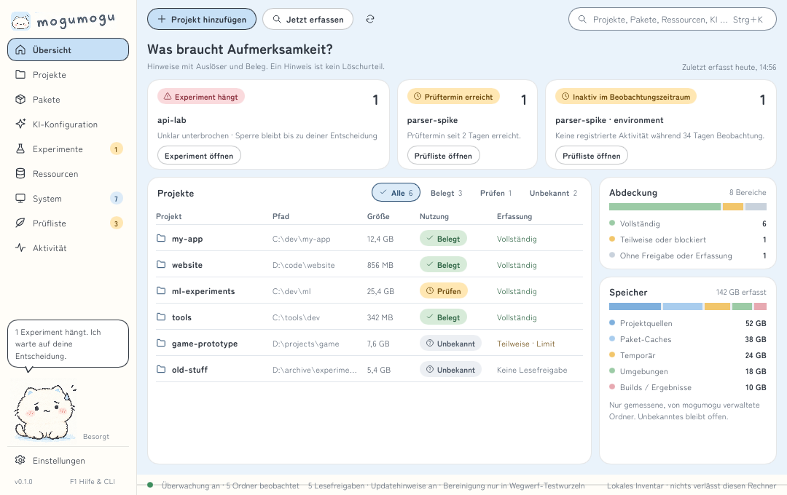

# mogumogu

**Lokales Entwicklungsinventar als Windows-Tray-App · Windows 10/11 · Rust · Slint · SQLite · GPL-3.0-only**

mogumogu zeigt, welche Entwicklungsressourcen auf deinem Rechner existieren, wem sie gehören, welche Nutzung tatsächlich beobachtet wurde und was eine Prüfung verdient: Projekte, Pakete aus neun Paketmanagern, Python-Umgebungen, Build-Ausgaben, Scratchpads und die KI-Konfiguration von zwölf Clients. Alles bleibt lokal – kein Konto, keine Cloud, keine Telemetrie.



Mochi begleitet die Oberfläche mit dem ausgewählten Kopf-Icon und handgeschriebenen
Schriftzug. Die eingebettete runde Schrift **Zen Maru Gothic** unterstützt auch
japanische Projektnamen. Mochis Ausdruck folgt Ansicht und Zustand: Mochi mampft
während einer Erfassung, schläft bei pausierter Überwachung und schaut besorgt,
wenn ein Experiment hängt oder ein Bereich nur teilweise erfasst ist.
[Gestaltung und Assets](design/brand/index.html).

> **Grundsatz:** Keine beobachtete Nutzung ist kein Entbehrlichkeitsnachweis. Registrieren erlaubt kein Lesen, Lesen erlaubt kein Löschen, und Bereinigung ist in dieser Version auf verwaltete Temp-Ausgabe in ausdrücklich markierten Wegwerf-Testwurzeln beschränkt.

## Stand

Die Basis des [Implementierungsplans](docs/IMPLEMENTIERUNGSPLAN.md) ist innerhalb der veröffentlichten [Unterstützungsmatrix](docs/UNTERSTUETZUNGSMATRIX.md) umgesetzt. Neu sind [Entwicklungsfunde mit Projektzuordnung, Laufwerksdashboard, Ordnerstruktur und Skill-Inhaltsansicht](docs/ENTWICKLUNGSFUNDE.md). Dazu kommen [Systembefund](docs/SYSTEMERKENNUNG.md), geführter Einstieg, Behandlung hängender Experimente, Tray-Pause, Ruhezeiten, optionaler Autostart, globale Suche und [Paketbelege](docs/PAKETPRUEFUNG.md). Scratchpad-Zweck und Konfigurationsvorrang werden nicht automatisch festgestellt. Die neuen Lesewege wurden durch einen getrennten Agenten geprüft; menschliche Sicherheitsabnahme, Windows-11-Abnahme und unabhängiger Löschpfad-Review G5 stehen aus. Produktive Bereinigung bleibt gesperrt. Details: [Validierung](docs/VALIDIERUNG.md), [Messbericht](docs/MESSBERICHT.md).

| Fähigkeit | Umfang |
|---|---|
| Tray und Dashboard | Kompaktes Windows-Fenster mit sieben Ansichten (Übersicht mit Prüfhinweisen, Projekte, Pakete, KI-Konfiguration, Experimente, Speicher, Einstellungen), Speicherübersicht für Laufwerke und Projekte, navigierbarer Ordnerstruktur, geführtem Einstieg, globaler Suche und Tastaturnavigation; Tray mit Pause, Hinweisen und Ruhezeiten; Lokalmodus als Standard, Demo separat |
| Lesefreigaben | Pro Ordner, an die Ordneridentität gebunden; Junctions, Symlinks und Cloud-Platzhalter werden nie verfolgt |
| Inventar | npm, pnpm, pip, uv, Cargo, NuGet statisch je Projekt; Scoop, Chocolatey, Windows-Softwareliste systemweit; deklariert/aufgelöst/installiert getrennt |
| KI-Konfiguration | Projektdateien für Agent Skills, Codex, Claude Code, Copilot/VS Code, Cursor, Gemini, Windsurf, Cline, Roo, OpenCode, Continue, Aider sowie persönliche Ordner bekannter Clients nach eigener Freigabe – als Daten, nie ausgeführt |
| Generationen | Vergleichsbasis ohne Meldungsflut, gruppierte Änderungen, keine falschen Entfernungen nach Teilläufen |
| Scratchpads und Sessions | Anlegen, Registrieren/Übernehmen und automatische Kandidatensuche in freigegebenen Bereichen; Funde für Skripte, Notebooks, Umgebungen, Ausgaben, Testdaten und Datenbanken; explizite Zuordnung mit Zweck und Schutz; verwaltete Läufe in Job-Objekten |
| Prüfhinweise und Bereinigung | Hinweise mit Evidenz, Plan per Fingerabdruck, journalisierte Ausführung, Abgleich nach Absturz |
| Paketbelege | Version und Quelle getrennt; Projekt-Lockbelege, mögliche Abhängigkeits-/Befehls-/MCP-Verweise, Abdeckung, Behalten-Vormerkung |
| Systembefund und globale Bestände | Werkzeuge im Suchpfad mit Nachweis (Pfad, Shim, App-Alias), bekannte Orte globaler Bestände; npm, uv-Tools, Cargo und NuGet nach eigener Ordnerfreigabe erfassbar; Entwicklungssuche liest nur Namen und Metadaten |
| Speicher und Inhaltsansicht | Laufwerkskapazität, belegter/freier Speicher und gemessene logische Projektanteile; Ordnerstruktur auf Anfrage in freigegebenen Bereichen; Skill-/Instruktionstexte schreibgeschützt, begrenzt und mit Redaktion erkannter sensibler Werte, ohne Inhaltspersistenz |
| Quellenhinweise | Opt-in je öffentlicher Quelle: neuere Version, npm-Abkündigung, Python-Projektstatus/Yanks, Cargo-Yanks, NuGet-Abkündigung und Alternative |
| CLI | Client des Besitzerprozesses über eine benutzergebundene Named Pipe, versioniertes JSON |

## Schnellstart

Die neuen Ansichten und ihre Grenzen beschreibt [Entwicklungsfunde, Speicher und Skill-Inhalte](docs/ENTWICKLUNGSFUNDE.md).

Voraussetzungen: Windows 10/11 x64, [rustup](https://rustup.rs) mit MSVC-Toolchain (die Version legt `rust-toolchain.toml` fest), Visual Studio C++ Build Tools mit Windows SDK.

```powershell
.\build.ps1                          # testen, Release bauen, lokales Inventar im Tray starten
.\build.ps1 -ShowDashboard           # lokales Inventar direkt öffnen
.\start.ps1 -ShowDashboard           # bereits gebaut mit lokalen Daten starten
```

Alternativ `build.cmd` doppelklicken (setzt die Execution Policy nur für diesen Prozess). Ausgabe: `dist\mogumogu\mogumogu.exe` und `mogumogu-cli.exe`. Kein Dienst und keine Installation von Voraussetzungen; Autostart nur, wenn du ihn in den Einstellungen einschaltest.

Der normale Start verwendet deine lokale Datenbank. Neue Inventare beginnen leer; der geführte Einstieg im Dashboard führt durch Ordnerwahl, Lesefreigabe und erste Erfassung (überspringbar, abschaltbar). Die separate Vorschau mit Beispieldaten startet nur ausdrücklich mit `-Mode Demo`; eine laufende Instanz vorher im Tray beenden.

```powershell
$cli = '.\dist\mogumogu\mogumogu-cli.exe'
& $cli project register --name api --path C:\dev\api
& $cli project approve --project 1
& $cli scan
& $cli review
```

Die vollständige Bedienung inklusive Scratchpads, verwalteten Läufen und dem Testexecutor beschreibt die [Anleitung](docs/ANLEITUNG.md).

## Architektur

Ein Cargo-Paket mit klar getrennten Modulen. Genau ein **Besitzerprozess** (Tray oder `--headless`) hält die Datenbank; Dashboard und CLI rufen dieselben Anwendungsfälle auf.

```text
Dashboard / CLI → Request → Owner-Worker → Core (service/)
                                            ├─ domain/        Zustände und Regeln
                                            ├─ storage/       SQLite und Journal
                                            ├─ inventory/     Statische Erfassung
                                            ├─ sessions/      Verwaltete Läufe
                                            ├─ updates/       Opt-in-Quellenhinweise
                                            └─ cleanup/       Journalisierter Testexecutor
```

Die [Architekturkarte](docs/ARCHITEKTUR.md) führt in fünf Dateien durch den Code,
zeigt Prozesse und Datenfluss und ordnet jede Verantwortung ihrem Modul zu.
Konkrete Änderungswege stehen in [Entwicklung](docs/ENTWICKLUNG.md).

Sicherheitsmodell in Kürze: Wurzeln werden einmal geöffnet und mit ihrer freigegebenen Identität verglichen; darunter wird jede Komponente **relativ zum Elternhandle** (`NtCreateFile`) ohne Folgen von Reparse Points geöffnet – ein nachträglich eingeschleuster Link kann den Zugriff nicht umleiten. Entfernt wird über genau das Handle, dessen Identität gerade geprüft wurde, nachdem die Aktion dauerhaft im Journal steht.

## Entwicklung

Gemeinsamer Prüfeinstieg: `python scripts/check.py` (Windows: Kern und Desktop;
Linux: portabler Kern). Reproduzierbar mit der festgelegten Rust-Toolchain im Container:

```powershell
docker compose run --build --rm checks
```

Docker dient der Entwicklung und den Kernprüfungen. Tray, Dashboard und die
Windows-Sicherheitsgrenzen werden weiterhin nativ geprüft. Details und
Cache-Nutzung: [Docker](docs/DOCKER.md); Änderungswege und UI-Modulaufbau:
[Entwicklung](docs/ENTWICKLUNG.md).

```powershell
python scripts/validate.py
cargo fmt --all -- --check
cargo clippy --locked --all-targets -- -D warnings
cargo test --locked --no-default-features --features network
```

Regeln für Mitwirkende und Coding-Assistenten stehen in [AGENTS.md](AGENTS.md) (Claude Code: [CLAUDE.md](CLAUDE.md)); projektspezifische Skills liegen unter `.agents/skills/` und als Kopie unter `.claude/skills/`. Beiträge: [CONTRIBUTING.md](CONTRIBUTING.md), Sicherheit: [SECURITY.md](SECURITY.md).

Weitere Dokumente: [Produktplan](docs/PROJEKTPLAN.md) · [Implementierungsplan](docs/IMPLEMENTIERUNGSPLAN.md) · [Windows-Abnahme](docs/WINDOWS-ABNAHME.md) · [Quellen](docs/QUELLEN.md) · [Designvarianten und Logos (Entwürfe)](design/variants/index.html) · [Frühere Designvorschau (HTML)](design/dashboard.html)

## Lizenz

GPL-3.0-only, siehe [LICENSE](LICENSE). Hinweise zu Slint, SQLite, Abhängigkeiten und Bildmaterial: [THIRD_PARTY.md](THIRD_PARTY.md).
