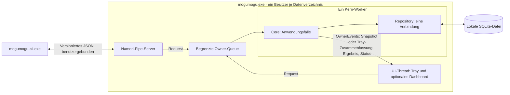

# Architektur: vom Einstieg zum Datenfluss

mogumogu ist eine native Windows-Anwendung mit einem Cargo-Paket, einer
Kernbibliothek und zwei Programmen. Das Dashboard verwendet Slint; die CLI
steuert denselben Kern über eine Named Pipe. Versionen und Features stehen in
[Cargo.toml](../Cargo.toml), verbindliche Modulregeln in [AGENTS.md](../AGENTS.md).

## In fünf Dateien einsteigen

1. [main.rs](../src/main.rs): Datenverzeichnis, Instanzsperre und Auswahl von Tray oder `--headless`.
2. [owner.rs](../src/owner.rs): Worker, begrenzte Queue und IPC.
3. [service/request.rs](../src/service/request.rs): typisierte Befehle und gemeinsame Weiterleitung an `Core`.
4. [service/mod.rs](../src/service/mod.rs): Zustand und Lebenszyklus des Kerns; Fachmodule ergänzen denselben Typ.
5. [storage/mod.rs](../src/storage/mod.rs): Repository, Transaktionen, Migrationen und Schreibrevision.

Danach dem gewünschten Anwendungsfall folgen. Ein Projekt muss registriert,
gesondert zum Lesen freigegeben und erfasst werden, bevor Inventarbelege
vorliegen. Diese Schritte sind getrennte Befehle.

## Prozesse und Threads



Nur der Kern-Worker koordiniert Anwendungsfälle und Datenbankänderungen.
Der Pipe-Server reicht Befehle weiter und wartet auf deren Ergebnis. Erfasst
wird nur auf Anfrage; es gibt keine Ordnerüberwachung, keinen Thread pro
Projekt und keine zusätzliche Async-Laufzeit.

Das Dashboard entsteht erst beim Öffnen. Schließen gibt Fenster und
Ansichtsmodelle frei; Tray, Kern und IPC bleiben aktiv. Im Headless-Modus
läuft derselbe Besitzer ohne Oberfläche. Die CLI hält keine zweite Datenbank.

## Verantwortlichkeiten

| Modul | Verantwortung | Darf nicht |
|---|---|---|
| [domain/](../src/domain/mod.rs) | Datentypen, Zustandsautomaten, Beweisstärke | Dateien, Datenbank oder Netzwerk öffnen |
| [service/](../src/service/mod.rs) | Eingaben prüfen, Fachregeln und Effekte koordinieren | SQL oder Windows-FFI implementieren |
| [desktop/](../src/desktop/mod.rs), [ui/](../ui/app.slint) | Absicht in `Request`, `Snapshot` in Slint-Modelle übersetzen | Inventar lesen, SQL oder Löschung in Callbacks ausführen |
| [storage/](../src/storage/mod.rs) | SQL, Migrationen, Generationen, Journal, Sicherungen | Eigenständig freigegebene Projektdateien erfassen |
| [inventory/](../src/inventory/mod.rs) | Statische Erfassung, Dateinamensuche, Größenmessung | Manager, Hooks oder gefundene Skripte starten |
| [adapters/](../src/adapters/mod.rs), [profiles/](../src/profiles/mod.rs), [parsers/](../src/parsers/mod.rs) | Unterstützte Formate in begrenzte Metadaten übersetzen | Gefundene Inhalte als Anweisungen behandeln |
| [fsread.rs](../src/fsread.rs), [platform/](../src/platform/mod.rs) | Freigegebene Lesezugriffe und gekapselte Windows-Operationen | Links oder ausgetauschten Wurzelidentitäten vertrauen |
| [review.rs](../src/review.rs) | Prüfhinweise mit Evidenz | Fehlende Beobachtung als Entbehrlichkeit ausgeben |
| [cleanup/](../src/cleanup/mod.rs) | Papierkorb-Pläne für wiederherstellbar belegte Ordner, erneute Prüfung an gehaltenen Handles, Journal je Ordner, Wiederanlauf | Ohne Beleg, Identitätsprüfung und dauerhaftes Journal verschieben; je endgültig löschen |

SQL bleibt ausschließlich in `storage/`, `unsafe` ausschließlich in
`platform/windows.rs`. [validate.py](../scripts/validate.py) prüft diese
Vorgaben lexikalisch; das ersetzt keinen Sicherheitsreview.

## Eine Erfassung verfolgen

```mermaid
sequenceDiagram
    participant Client as Dashboard / CLI
    participant Owner as Owner-Worker
    participant Core as service::Core
    participant Repo as storage::Repository
    participant Scan as inventory
    participant Files as fsread / platform
    participant Parse as adapters / profiles
    Client->>Owner: Request::Scan (freigegebener Scope)
    Owner->>Core: dispatch
    Core->>Repo: Scope und freigegebene Identität lesen
    Core->>Repo: begin_generation
    Core->>Scan: scan(Identität, Pfad, Budgets)
    Scan->>Files: Handle-relative, begrenzte Lesezugriffe
    Files-->>Scan: Dateinamen / ausgewählte Inhalte
    Scan->>Parse: Statische Metadaten auswerten
    Parse-->>Scan: Typisierte Inventarbelege
    Scan-->>Core: Ergebnis mit Vollständigkeit und Problemen
    Core->>Repo: finish_generation
    Core-->>Owner: ScanReport
    Owner-->>Client: Ergebnis; aktualisierter Snapshot für die UI
```

Nur vollständige Generationen ersetzen den veröffentlichten Vergleichsstand.
Teilläufe behalten ältere vollständige Belege und zeigen die Lücke. Eine
Projekt-Suchwurzel liest nur Dateinamen; ein gefundener Kandidat erhält durch
seine Registrierung keine Lesefreigabe.

## Paketprüfung und Lesemodelle

Die Paketprüfung hat drei private Teile hinter derselben öffentlichen
`Core::package_page`-Schnittstelle (`package_report` ist die ungefilterte erste
Seite). Text, Filterchip und Manager wirken vor dem Blättern; Zähler je Chip
entstehen aus demselben Durchlauf:

| Datei | Aufgabe |
|---|---|
| [service/packages.rs](../src/service/packages.rs) | Begrenzte Datensätze laden, Cache prüfen, Behalten-Entscheidungen speichern |
| [packages/analysis.rs](../src/service/packages/analysis.rs) | Gelieferte Metadaten, Quellenstatus und Uhrzeit zu einem sortierten Bericht verbinden |
| [packages/references.rs](../src/service/packages/references.rs) | Projekt-, Deklarations-, Abhängigkeits-, Befehls- und MCP-Belege indizieren und abgleichen |

Die Auswertung kennt weder `Core` noch `Repository` oder Netzwerkclients.
`PublishedItem` ist dabei eine geliehene Datenprojektion aus
dem Repository. Version und Quelle bleiben Teil der Paketidentität. Mögliche
Verweise bleiben von passenden Projekt-Lockbelegen getrennt; fehlende Verweise
verleihen kein Löschrecht. Details: [Paketprüfung](PAKETPRUEFUNG.md).

[service/snapshot.rs](../src/service/snapshot.rs) baut das begrenzte
Dashboard-Lesemodell auf und reicht bereits geladene Projekt-/Scope-Daten an
Paketprüfung, Projektsuche und Inventarfundstellen weiter. Der Paketcache hält
eine Seite. Er gilt nur für dieselbe Repository-Revision und Seitenauswahl, und
nur bis die nächste noch frische Quellenprüfung veraltet; die Uhr wirkt auf den
Bericht ausschließlich über diese Grenze. Jeder erfolgreiche Schreib-Commit
ändert die Revision. Budgets stehen gemeinsam in [limits.rs](../src/limits.rs).

Der vollständige Snapshot entsteht nur, wenn `OwnerEvents::wants_snapshot`
zutrifft: im Desktop bei sichtbarem Dashboard, im Headless-Betrieb nie. Sonst
veröffentlicht der Besitzer nach Änderungen eine `TraySummary` mit Modus,
Einstellungen und Anzahl der Prüfhinweise, die genauso wie im Snapshot
ausgewertet werden. Beim Öffnen zeigt das Dashboard sofort den letzten Stand und
fordert einen frischen Snapshot an.

[service/status.rs](../src/service/status.rs) liest dagegen nur Zähler über
[storage/summary.rs](../src/storage/summary.rs).
Ein Statusaufruf erzeugt keinen Dashboard-Snapshot oder Paketbericht.
Seine Gesamtzahlen bleiben unabhängig von der Seitenbegrenzung der UI.

## Systembefund, Suche und Erfassungssteuerung

| Datei | Aufgabe |
|---|---|
| [inventory/system.rs](../src/inventory/system.rs) | Befehle im Suchpfad und bekannte Orte per `symlink_metadata` prüfen; Umgebung und Dateisystem über die Schnittstellen `Env` und `Probe`, damit Tests ohne echten Rechner laufen |
| [domain/system.rs](../src/domain/system.rs) | `SystemReport` mit Gruppe, Nachweisart, Platzhalterpfad und Bezug zu einer Freigabe |
| [service/system.rs](../src/service/system.rs) | Befund zwischenspeichern, auf Wunsch neu prüfen und mit bestehenden Freigaben abgleichen |
| [service/search.rs](../src/service/search.rs) | Eine Suche über Projekte, Pakete (SQL mit maskiertem `LIKE`), Ressourcen, KI-Einträge und Systembefund |
| [fsread.rs](../src/fsread.rs) `ScanControl` | Fortschritt und kooperativer Abbruch per Atomics; das `Budget` stoppt am nächsten Eintrag, die Generation bleibt teilweise |

Der Systembefund liest keine Inhalte und folgt keiner Verknüpfung; geprüft werden
nur lokale feste Laufwerke. Persönliche KI-Ordner sind eigene Freigaben
(`ScopeKind::UserAi`, Spalte `realm` aus Migration 004). Ihre Erfassung betritt
nur Ordner, die ein Katalogmuster erreichen kann (`Catalog::user_routes`).
Das Dashboard liest `ScanControl` über `service`, nicht über die Lesegrenze.

## Änderungen gezielt beginnen

Neue Befehle beginnen bei `service/request.rs` und dem passenden Fachmodul:
`inventory` für Freigaben/Scans/Fundstellen, `discovery` für Projektkandidaten,
`system` für den Systembefund, `search` für die bereichsübergreifende Suche,
`packages` für Paketprüfung, `resources` für Scratchpads/Schutz/Prüfliste,
`tidy` für den Aufräumbericht, `filters` für den Kontextfilter und
`maintenance` für Einstellungen/Sicherung/Papierkorb-Pläne.
Öffentliche Typen bleiben über `service` erreichbar; interne Helfer bleiben privat.

Für eine UI-Änderung zuerst [desktop/actions.rs](../src/desktop/actions.rs),
[desktop/view.rs](../src/desktop/view.rs) und die betroffene Slint-Seite lesen.
Für ein neues Paketformat beim Adaptervertrag beginnen. Schemaänderungen
erhalten eine neue Migration und einen Sicherungs-/Migrationstest.

Prüfeinstieg ist `python scripts/check.py`; er prüft Modulverträge, Formatierung,
Clippy, den Kern und unter Windows die native
UI-Kompilierung. Fachliche Regressionen liegen unter `tests/`; die
Referenzlast ist [tests/performance.rs](../tests/performance.rs).
Konkrete Änderungswege und Befehle: [Entwicklung](ENTWICKLUNG.md).

Produktive Bereinigung bleibt gesperrt (`cleanup::PRODUCTION_ENABLED = false`);
G5 und die manuellen Windows-Abnahmen stehen separat in
[WINDOWS-ABNAHME.md](WINDOWS-ABNAHME.md). Der
[Produktplan](PROJEKTPLAN.md) enthält auch Ausbauziele; diese Architekturkarte
beschreibt den vorhandenen Code.
