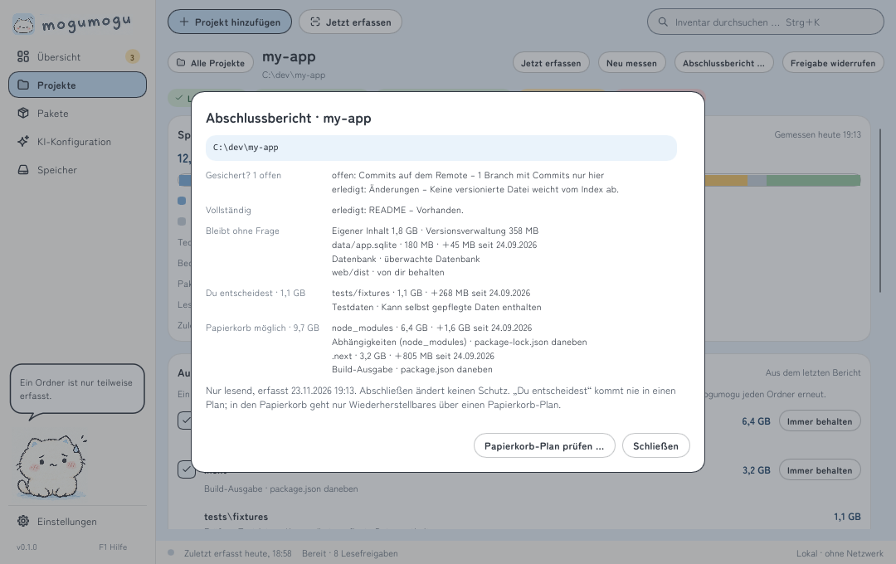
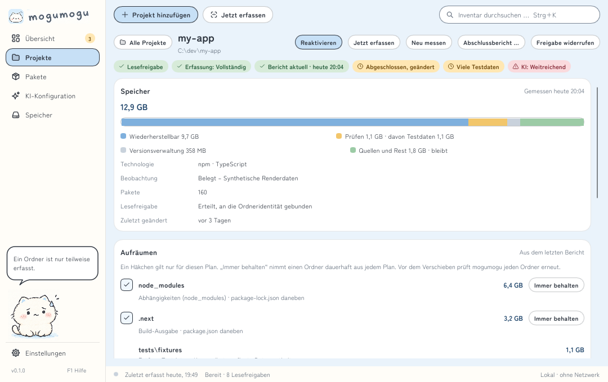

# Projekt abschließen: Spezifikation

Stand: 23. November 2026. Die Entscheidungen in [Abschnitt 8](#8-entscheidungen)
sind getroffen. **Umgesetzt sind alle drei Schritte**: der Abschlussbericht, der Zustand
„abgeschlossen“ mit Verlauf und der Scratchpad-Schalter
([Abschnitt 9](#9-reihenfolge)). Der Schalter lockert eine Schutzregel und
wartet auf den zweiten Review.

Ist ein Projekt fertig, zeigt mogumogu in einem Abschlussbericht, was bleiben
muss, was in den Papierkorb kann und worüber du entscheiden musst, besonders
bei wachsenden Testdaten. Abschließen ist eine eigene Entscheidung, getrennt vom
Aufräumen erzeugter Dateien ([Implementierungsplan, Abschnitt 10, Schritt 3](IMPLEMENTIERUNGSPLAN.md#10-nächste-schritte)).
Archivieren, Verschieben und Löschen des Projekts bleiben außerhalb des Umfangs.

## 1. Grundsätze

- **Abschließen ändert keinen Schutz.** Das Projekt bleibt geschützt, keine
  Haltung endet, und nichts wird wiederherstellbar, was es vorher nicht war.
  Neue Regeln dürfen nur enger machen ([AGENTS.md](../AGENTS.md)).
- **Keine neue Lesegrenze.** Der Bericht verbindet, was es schon gibt: einen
  frischen Aufräumbericht, die offenen Punkte, den Berichtsverlauf, Haltungen,
  Läufe, überwachte Datenbanken und Docker-Einbindungen.
- **Entfernt wird wie bisher** nur über einen Papierkorb-Plan aus dem
  Aufräumbericht, bestätigt im Dashboard, bis G5 nur in Wegwerf-Testwurzeln
  ([Projektbewusste Bereinigung](PROJEKTBEWUSSTE-BEREINIGUNG.md)).
- **„Abgeschlossen“ heißt nie „kann weg“.** Unbekannt bleibt unbekannt, und
  „erledigt“ in den offenen Punkten bleibt kein Löschurteil.

## 2. Zustände

| Zustand | Bedeutung |
|---|---|
| Aktiv | Standard, auch für alle Projekte nach dem Upgrade |
| Abgeschlossen | Du erklärst: fertig, das Ergebnis bleibt |

**Reaktivieren** setzt ein abgeschlossenes Projekt zurück auf aktiv und ändert
sonst nichts. Jeder Wechsel ist ein datiertes Ereignis; ein Abschluss trägt den
Fingerabdruck des Berichts, auf dem er beruht. Eine Notiz je Wechsel gibt es
nicht, solange es kein Eingabefeld dafür gibt. Einen dritten Zustand
„Stilllegen“ gibt es nach E1 nicht.

## 3. Abschlussbericht

„Abschlussbericht …“ auf der Projektseite (CLI: `project finish-report --project ID`)
erfasst das Projekt frisch und zeigt vier Teile. „Abschließen“ im Dialog
bestätigt genau diesen Bericht per Fingerabdruck: Er umfasst die Punkte unter
„Gesichert“ und welche Ordner in welchem Teil stehen, nicht aber Größen und
Zeiten, damit ein wachsendes Log keinen neuen Bericht erzwingt. mogumogu
erstellt den Bericht beim Bestätigen neu; weicht der Fingerabdruck ab, ist ein
neuer Bericht nötig.

**A. Ist die Arbeit gesichert?** Die Punkte der Gruppe „Gesichert“: Commits,
Remote, Commits auf dem Remote, zurückgelegte und vorgemerkte Änderungen,
geänderte Dateien, Dateien nur auf diesem Rechner, weitere Arbeitskopien. Offene
und unbekannte Punkte stehen zuerst. Der Dialog nennt sie beim Abschließen
ausdrücklich mit, etwa „3 Commits liegen nur hier“. Unbekannt zählt nie als
erledigt. Die Punkte der Gruppe „Vollständig“ (README, Lizenz, Tests, CI,
Lockfile) stehen zur Kenntnis daneben.

**B. Bleibt ohne Frage.** Versionierte Dateien und der übrige eigene Inhalt,
Projektdateien, alles mit einer Haltung (behalten, Lauf, überwachte Datenbank,
Docker-Einbindung) und geschützte Ressourcen. Gezeigt mit Größe, damit sichtbar
wird, was das Projekt dauerhaft belegt.

**C. Du entscheidest.** Alles der Klasse „Prüfen“ ohne Haltung: Testdaten,
Datenbanken, Logs, große Dateien, Umgebungen oder Ausgaben ohne Datei, die sie
neu baut, und Reste von KI-Agenten. Je Ordner Größe, letzte Änderung, Beleg und
Wachstum seit dem ältesten gespeicherten Bericht der letzten 90 Tage. Hat dieser
Bericht den Ordner nicht unter seinen größten Einträgen geführt, bleibt das
Wachstum unbekannt, nie null. Behalten geht wie heute über „Immer behalten“ auf
der Projektseite. Nach E3 kommt aus diesem Teil nichts in den Papierkorb.

**D. Kann in den Papierkorb.** Alles der Klasse „Wiederherstellbar“ mit Beleg
und Platz, vorausgewählt. Führt in den gewohnten Papierkorb-Plan mit Journal,
erneuter Prüfung und G5-Sperre. Daneben steht, wie viel Platz frei würde und
wie viel bleibt.

**Außerhalb des Projekts**, nur zur Kenntnis: Läufe dieses Projekts, die noch
nicht freigegeben sind; Container, die Projektordner einbinden. Später auch
globale Caches und Werkzeuge, die nur dieses Projekt nutzte, sobald es
„Genutzt von“ gibt (Plan, Abschnitt 10, Schritt 1).

## 4. Nach dem Abschluss

- Die Projekttabelle filtert nach „Abgeschlossen“. Die Übersicht zählt
  abgeschlossene Projekte getrennt und zeigt für sie keinen Hinweis „ruhend“,
  weil Ruhe hier erwartet ist.
- **Seit dem Abschluss geändert:** Zeigt ein späterer Bericht eine Datei, die
  neuer ist als der Abschluss (außer Ausgaben, Caches und Versionsverwaltung),
  steht auf der Projektseite „Abgeschlossen, geändert“ mit „Reaktivieren“.
  Automatisch ändert sich nichts. `HEAD` wird nicht verglichen: mogumogu
  speichert keinen Git-Stand ([AGENTS.md](../AGENTS.md)), neue Commits allein
  zeigen sich deshalb nicht.
- Abgeschlossene Projekte bleiben in „Alles erfassen“, sonst gäbe es den
  Hinweis nicht.

## 5. Scratchpads

Bis Schritt 3 hielt ein geschütztes Scratchpad jeden Plan für Ordner darin auf,
auch `node_modules` neben einem Lockfile ([gate.rs](../src/cleanup/gate.rs),
`unprotected`). Der Plan fragt, wie ein geschütztes Scratchpad Pläne darin
zulassen kann. Nach E4 gilt Option B, mit zweitem Review; A bleibt die
Rückfallebene. **Umgesetzt (Schritt 3, zweiter Review offen):** ein Schalter je
Scratchpad (`resources.plans_inside`, Schema v12, aus nach dem Upgrade), im
Dashboard unter **Projekte → Ressourcen → Scratchpad → Erzeugtes darin zulassen …**
mit einer Erklärung vor dem Zulassen. `unprotected` lässt dann nur Ordner
**echt darin** durch; jede Schreibweise wird einzeln geprüft, das Scratchpad
selbst und ein Ordner, der es enthält, bleiben gesperrt, ebenso jede andere
geschützte Ressource darin. Beleg, Git-Stand, Haltungen und behaltene Ordner
gelten wie immer, und der Executor prüft vor jedem Verschieben erneut: Wer den
Schalter nach der Bestätigung und vor der Ausführung zurücknimmt, stoppt den
Plan; einen schon laufenden Plan hält das nicht an, weil der Besitzerprozess
einen Auftrag nach dem anderen ausführt. Nur ein geschütztes Scratchpad lässt
sich öffnen, und „Schützen“ schließt es wieder. Über die Pipe lehnt `owner.rs`
das Zulassen ab; zurücknehmen geht auch per `scratch protect-inside`. Auch als
Scratchpad übernommene Teilprojekte (Funde der Art „Projekt“) haben den
Schalter; Öffnen lässt dann Wiederherstellbares im ganzen Teilprojekt zu.

- **A. Bleibt so.** Am sichersten und einfachsten; Erzeugtes in Scratchpads
  räumst du selbst auf.
- **B. Schalter je Scratchpad: „Erzeugtes darin darf in Pläne“.** Nur
  „Wiederherstellbar“ mit Beleg, nur im Dashboard einschaltbar; das Scratchpad
  selbst und alles unter „Prüfen“ bleiben geschützt. Lockert eine Regel und
  braucht den zweiten Review.
- **C. Ein abgeschlossenes Scratchpad** (eigener Zustand wie in Abschnitt 2)
  lässt Pläne für Wiederherstellbares darin zu. Lockert ebenfalls und koppelt
  zwei Entscheidungen.

## 6. Daten und Schnittstellen

- **Schema v11:** Tabelle `project_lifecycle` (`project_id`, `state` in
  `active`/`finished`, `at`, `fingerprint` genau bei `finished`), höchstens 50
  Einträge je Projekt. Der neueste Eintrag ist der Zustand; ohne Eintrag ist ein
  Projekt aktiv. Sicherung vor der Migration wie gewohnt, kein Projekt wechselt
  dabei den Zustand. Die Demo zeigt keine abgeschlossenen Projekte.
- **Anwendungsfälle** in [service/finish.rs](../src/service/finish.rs):
  `FinishReport { project_id }` (misst neu), `FinishProject { project_id,
  confirmation }` (Fingerabdruck), `ReactivateProject { project_id }` und
  `LifecycleHistory { project_id }`.
- **CLI:** `project finish-report`, `project reactivate` und `project lifecycle`,
  je mit `--project ID`. Nach E2 schließt nur das Dashboard ab.

## 7. Abnahme

| Szenario | Muss gelten |
|---|---|
| Projekt abschließen | `protected`, Haltungen, behaltene Ordner und die Menge des Wiederherstellbaren sind vorher und nachher gleich |
| Ordner unter „Prüfen“ | Kommt nie in einen Plan, auch nicht nach dem Abschluss (E3) |
| Offener oder unbekannter Punkt unter „Gesichert“ | Abschließen nur nach ausdrücklicher Bestätigung genau dieses Punkts |
| Stand ändert sich zwischen Bericht und Bestätigung | Abgelehnt, neuer Bericht nötig |
| Änderung nach dem Abschluss | Hinweis „Seit dem Abschluss geändert“, kein automatischer Wechsel |
| Reaktivieren | Nur der Zustand ändert sich |
| Upgrade v10 → v11 | Sicherung, alle Projekte aktiv, Demo und lokal getrennt |
| Abschließen über die Pipe | Abgelehnt, auch mit richtigem Fingerabdruck (E2) |

## 8. Entscheidungen

Am 23. November 2026 so entschieden, wie empfohlen.

| Nr. | Frage | Entscheidung |
|---|---|---|
| E1 | Eigener Zustand „stillgelegt“ (pausiert, Rückkehr erwartet) neben „abgeschlossen“? | Nein, zuerst nur „abgeschlossen“ und Reaktivieren. Ein zweiter Zustand lohnt erst, wenn er etwas anderes bewirkt. |
| E2 | Darf die CLI (und damit ein Agent) abschließen? | Nein, nur das Dashboard, wie das Freigeben eines Laufs. Bericht und Reaktivieren auch per CLI, denn beides lenkt nur Aufmerksamkeit. |
| E3 | Dürfen Ordner unter „Prüfen“ beim Abschluss nach Einzelbestätigung in den Papierkorb? | Nein. Das lockert die Grundregel, dass nur ein Wiederherstellungsbeleg „wiederherstellbar“ trägt. Der Bericht zeigt Pfad, Größe und Wachstum; gelöscht wird außerhalb von mogumogu. |
| E4 | Scratchpads: A, B oder C aus Abschnitt 5? | B, mit zweitem Review. A ist die sichere Rückfallebene. |
| E5 | Blockiert ein offener Punkt unter „Gesichert“ das Abschließen? | Nein, er muss aber ausdrücklich bestätigt werden. |

## 9. Reihenfolge

1. **Abschlussbericht, nur lesend:** CLI und Dialog auf der Projektseite, ohne
   Schemaänderung. Liefert schon den Hauptnutzen. **Umgesetzt am 23. November
   2026:** [domain/finish.rs](../src/domain/finish.rs) teilt einen frischen
   Aufräumbericht auf, [service/finish.rs](../src/service/finish.rs) misst dafür
   neu und nutzt dieselben Haltungen; Tests `the_finishing_report_sorts_every_folder_once_and_changes_nothing`
   und `the_finishing_report_reads_through_the_owner_in_json_and_text`.
2. **Zustand und Verlauf** (Schema v11), Filter und der Hinweis nach dem
   Abschluss. **Umgesetzt am 23. November 2026**, Tests
   `finishing_binds_the_report_changes_no_protection_and_reactivating_undoes_only_the_state`,
   `only_the_dashboard_finishes_a_project_and_the_cli_reactivates_it` und
   `v10_projects_stay_active_and_the_lifecycle_table_refuses_odd_rows`.
3. **Scratchpads** nach E4, mit zweitem Review. **Umgesetzt am 23. November
   2026, Review offen**, Tests `an_opened_scratchpad_lets_only_folders_strictly_inside_through`,
   `everything_else_keeps_protecting_as_before`,
   `an_opened_scratchpad_lets_only_recoverable_folders_inside_go`,
   `only_the_dashboard_opens_a_scratchpad_for_plans_and_the_cli_closes_it`,
   `v11_scratchpads_stay_closed_and_only_scratchpads_can_be_opened` und der
   Vertrag `test_loosening_protection_and_deciding_stay_with_the_person`.
